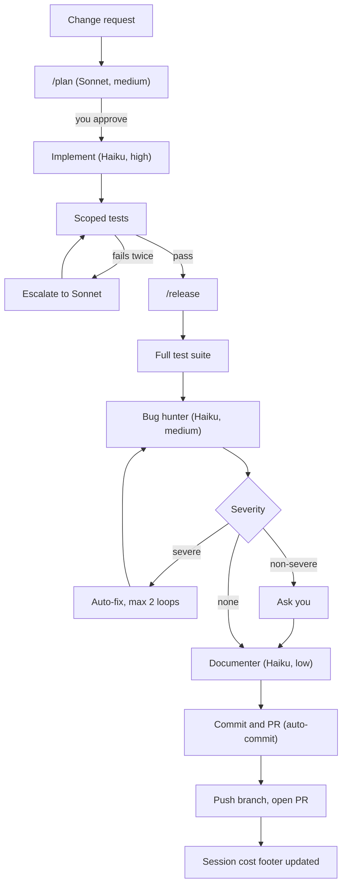

# dotclaude

Personal Claude Code configuration: global rules, agents, skills, commands,
and a non-blocking change pipeline. Public, MIT-licensed, no secrets.

> **This repo is not a project you work inside — it's the source for config
> that gets *installed* into `~/.claude/` (or a project's own `.claude/`) and
> used everywhere else.** Everything under `.claude/`, plus `CLAUDE.md` and
> the GitHub templates, must stay agnostic to dotclaude's own layout — never
> assume some other project has a `docs/decisions/`, a `docs/plans/`, this
> repo's test runner, or any other dotclaude-specific structure just because
> dotclaude itself does. `scripts/validate_repo.py` enforces this
> automatically on every change (see `docs/decisions/0008-config-must-be-repo-agnostic.md`).
> Only `scripts/validate_repo.py`, `tests/`, and the `docs/` folder are
> dotclaude's own dev tooling — those are never installed anywhere.

## Install

```
python3 scripts/install.py                 # user scope (default): -> ~/.claude/
python3 scripts/install.py --mode project --target /path/to/some/repo
python3 scripts/install.py --copy           # copy instead of symlink (default: symlink)
python3 scripts/install.py --dry-run        # preview with no changes
python3 scripts/install.py --uninstall      # remove what a prior run installed
```

- **User scope** (default): installs `CLAUDE.md`, `.claude/settings.json`,
  `.claude/{agents,commands,skills}`, the PR/issue templates (to
  `~/.claude/templates/`), and `session_cost.py` + its config (to
  `~/.claude/dotclaude-scripts/`) — all applied across every project you
  work in afterward.
- **Project scope**: installs `CLAUDE.md` and `.claude/{agents,commands,skills}`
  into one specific project. Use this for a project where you want a GitHub
  Actions workflow (like `claude-pr-review.yml`) to see these agents — a CI
  runner only checks out that project, not your `~/.claude/`.
- Everything is symlinked (or copied with `--copy`) whole, **except
  `settings.json`, which is merged** — every run, not just the first. Your
  existing `hooks`, `theme`, `model`, or anything else dotclaude doesn't own
  is left untouched; only `permissions` (unioned) and `statusLine`/`model`
  (added only if entirely absent) come from dotclaude, and a run that
  changes nothing reports `unchanged`. See
  `docs/decisions/0010-settings-json-is-merged-not-linked.md`.
- The installer never overwrites a file that already differs from this
  repo's version unless you pass `--force`; it never touches files it didn't
  create itself. `--uninstall` leaves `settings.json` alone entirely (it's
  merged content, not a file this installer fully owns).

Personal overrides (API keys, local-only permissions) go in that project's
`.claude/settings.local.json`, which is gitignored — never in
`.claude/settings.json`.

## Components

| Type | Name | Purpose |
|---|---|---|
| Agent | `planner` | Read-only analysis and plan output (Sonnet, medium) |
| Agent | `implementer` | Makes the approved change (Haiku, high) |
| Agent | `bug-hunter` | Security, contracts, bad-practice review (Haiku, medium) |
| Agent | `documenter` | Updates docs after review passes (Haiku, low) |
| Agent | `token-auditor` | On-demand context-bloat report (Haiku, low) |
| Command | `/plan` | Entry point: planner → plan for approval |
| Command | `/release` | Full pipeline: tests → bug-hunter → docs → PR |
| Command | `/pr` | Commit and open a PR without the full pipeline |
| Skill | `commit-and-pr`, `github-ops`, `testing-mindset`, `release-policy`, `token-budget`, `session-cost-report`, `mcp-gmail-ops`, `mcp-drive-ops`, `mcp-calendar-ops`, `mcp-docs-ops`, `playwright-ops` | See `.claude/skills/*/SKILL.md` |

See `docs/pipeline.md` for the prose walkthrough and `docs/references.md` for
what was adapted from [awesome-copilot](https://github.com/github/awesome-copilot).

## GitHub PR review and templates

`.github/workflows/claude-pr-review.yml` (this repo's own CI — project
scope, see the Install section to use it in another repo) runs `bug-hunter`
against a pull request — same agent and severity policy as `/release`, no
duplicate agent (see `docs/decisions/0005-reuse-bug-hunter-for-ci-review.md`).
It's inactive until you add a `CLAUDE_CODE_OAUTH_TOKEN` or `ANTHROPIC_API_KEY`
secret, and triggers on an `@claude review` comment or manual dispatch rather
than every push — see `docs/decisions/0007-pro-plan-cost-sustainability.md`
for why.

The PR/issue templates are different: they're personal defaults, installed
to `~/.claude/templates/` and used by `commit-and-pr`/`github-ops` in *any*
project — preferring that project's own `.github/` template when it has one.
They also happen to double as this repo's own native GitHub templates. See
`docs/decisions/0009-templates-are-personal-not-github-native.md`.

## Pipeline

<!-- pipeline:start -->


The diagram's boxes map to the `planner`, `implementer`, `bug-hunter`, and
`documenter` agents (in that order), invoked by `/plan` and `/release`. Two
more entry points sit outside the diagram: `/pr` runs the `commit-and-pr`
skill directly, for a change you've already verified yourself and don't want
the full `/release` pipeline for. The `token-auditor` agent runs on demand
(not part of this diagram) to report context bloat in `CLAUDE.md`, skills,
and agents.

Severe findings are security issues, data loss, failing tests, and broken
public contracts. Everything else asks you first. No step here is a hook —
`.claude/settings.json` has no `hooks` key; this is a sequence of steps
inside `/release` itself.
<!-- pipeline:end -->

## Token efficiency

- Keep `CLAUDE.md` under 150 lines; put detail in the skill that owns it.
- Read files with `offset`/`limit`; delegate MCP-heavy or exploratory work to
  a Haiku subagent; run `/clear` between unrelated tasks.
- Enable only the MCP connectors a given project actually needs.
- `scripts/validate_repo.py` enforces the structural rules above on every PR
  (advisory, via `.github/workflows/docs-check.yml` — it never blocks local
  work).

## Cost reporting

`scripts/session_cost.py` is installed to `~/.claude/dotclaude-scripts/` (see
Install) and reads the current session's transcript from wherever you're
working, printing a Markdown table of estimated USD cost per model from its
pricing config. Pricing is a dated cache, not a hardcoded constant — it
carries `_fetched_at`/`_max_age_days`, and the script warns when it's stale
rather than silently using outdated numbers; see `session-cost-report` for
the refresh procedure. This is an **estimate at API list prices** — a
Pro/Max plan is a flat subscription, not billed per token — and
`commit-and-pr` writes it into every PR body as a footer.
