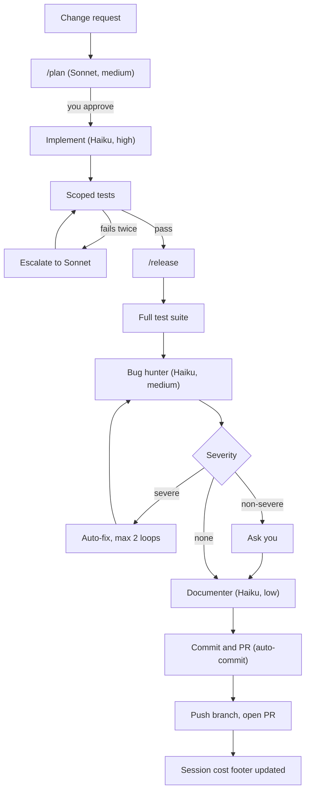

# dotclaude

Personal Claude Code configuration: global rules, agents, skills, commands,
and a non-blocking change pipeline. Public, MIT-licensed, no secrets — see
`CLAUDE.md` for the rules this repo holds itself to.

## Install

Pick a scope:

- **User scope** (every project): copy or symlink `.claude/agents`,
  `.claude/commands`, `.claude/skills`, and `CLAUDE.md` into `~/.claude/` and
  `~/CLAUDE.md`.
- **Project scope** (one project): copy or symlink the same directories into
  that project's `.claude/` and its root `CLAUDE.md`.

Personal overrides (API keys, local-only permissions) go in
`.claude/settings.local.json`, which is gitignored — never in
`.claude/settings.json`.

## Components

| Type | Name | Purpose |
|---|---|---|
| Agent | `planner` | Read-only analysis and plan output (Sonnet, medium) |
| Agent | `implementer` | Makes the approved change (Haiku, high) |
| Agent | `bug-hunter` | Security, contracts, bad-practice review (Haiku, medium) |
| Agent | `documenter` | Updates docs after review passes (Haiku, low) |
| Agent | `token-auditor` | On-demand context-bloat report (Haiku, low) |
| Command | `/plan` | Entry point: planner → plan for approval |
| Command | `/release` | Full pipeline: tests → bug-hunter → docs → PR |
| Command | `/pr` | Commit and open a PR without the full pipeline |
| Skill | `commit-and-pr`, `github-ops`, `testing-mindset`, `release-policy`, `token-budget`, `session-cost-report`, `mcp-gmail-ops`, `mcp-drive-ops`, `mcp-calendar-ops`, `mcp-docs-ops`, `playwright-ops` | See `.claude/skills/*/SKILL.md` |

See `docs/pipeline.md` for the prose walkthrough and `docs/references.md` for
what was adapted from [awesome-copilot](https://github.com/github/awesome-copilot).

## GitHub PR review and templates

`.github/workflows/claude-pr-review.yml` runs `bug-hunter` against a pull
request — same agent and severity policy as `/release`, no duplicate (see
`docs/decisions/0005-reuse-bug-hunter-for-ci-review.md`). It's inactive until
you add a `CLAUDE_CODE_OAUTH_TOKEN` or `ANTHROPIC_API_KEY` secret, and
triggers on an `@claude review` comment or manual dispatch rather than every
push — see `docs/decisions/0007-pro-plan-cost-sustainability.md` for why.
`commit-and-pr` and `github-ops` fill `.github/pull_request_template.md` and
the forms in `.github/ISSUE_TEMPLATE/` for every PR and issue respectively.

## Pipeline

<!-- pipeline:start -->

The diagram's boxes map to the `planner`, `implementer`, `bug-hunter`, and
`documenter` agents (in that order), invoked by `/plan` and `/release`. Two
more entry points sit outside the diagram: `/pr` runs the `commit-and-pr`
skill directly, for a change you've already verified yourself and don't want
the full `/release` pipeline for. The `token-auditor` agent runs on demand
(not part of this diagram) to report context bloat in `CLAUDE.md`, skills,
and agents.

Severe findings are security issues, data loss, failing tests, and broken
public contracts. Everything else asks you first. No step here is a hook —
`.claude/settings.json` has no `hooks` key; this is a sequence of steps
inside `/release` itself.
<!-- pipeline:end -->

## Token efficiency

- Keep `CLAUDE.md` under 150 lines; put detail in the skill that owns it.
- Read files with `offset`/`limit`; delegate MCP-heavy or exploratory work to
  a Haiku subagent; run `/clear` between unrelated tasks.
- Enable only the MCP connectors a given project actually needs.
- `scripts/validate_repo.py` enforces the structural rules above on every PR
  (advisory, via `.github/workflows/docs-check.yml` — it never blocks local
  work).

## Cost reporting

`scripts/session_cost.py` reads the local session transcript and prints a
Markdown table of estimated USD cost per model, from `config/pricing.json`.
This is an **estimate at API list prices** — a Pro/Max plan is a flat
subscription, not billed per token — and `commit-and-pr` writes it into every
PR body as a footer.
